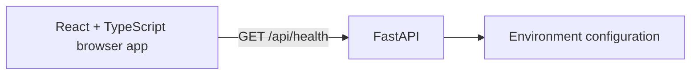
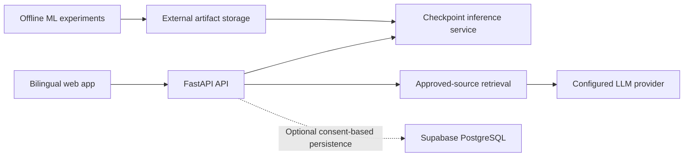

# Architecture

## Phase 1 foundation

The frontend has one setup-status route and a fallback route. Shared API access
is isolated from presentation. It displays actual backend connectivity and
explicitly identifies prediction and chat capabilities as not implemented.

FastAPI uses an application factory, a lifespan hook for logging, a versioned
Python package, Pydantic response models, and environment-based settings. The
only product endpoint implemented is `GET /api/health`. OpenAPI documents it.
Application route errors use `{ "error": { "code": "...", "message": "..." } }`; request
validation errors may additionally contain a safe field-level details list.
CORS preflight rejection uses the middleware's standard HTTP 400 response.

The health check is HTTP liveness only. There is no model, LLM provider,
database, image storage, user account, or external data processing in this phase.

## Intended architecture — not yet implemented

Later APIs: disease list/detail, image prediction, chatbot, and model metadata.
Their absence in Phase 1 is intentional. An unavailable classifier must return
503, never a synthetic successful prediction. Authentication, persistence, and
retention must be designed before storing user data.

See [the plan](IMPLEMENTATION_PLAN.md) for phase boundaries and
[limitations](LIMITATIONS.md) for current capability status.
