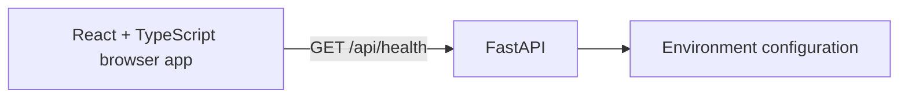
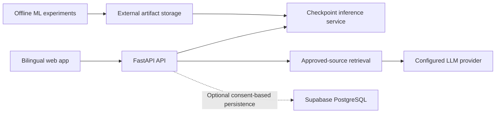

# Architecture

## Current implementation — Phase 2 frontend

The frontend has a reusable sticky navigation/footer shell and seven main routes:
home, About Nai Miris, growing guide, disease detector, disease library, chatbot,
and About Project. The library has parameterized detail routes and the app has a
404 fallback. Route changes update the title and move focus to main content.

`frontend/src/data/content.ts` contains attributed, general pepper education.
The guide and library do not depend on an available backend. These summaries
still require local agronomic review and are not validated Nai Miris treatment
prescriptions. The disease API client is prepared but does not replace the local
educational content with unreviewed server records.

`frontend/src/lib/api.ts` centralizes the existing health endpoint and proposed
prediction, disease and chat contracts. It validates responses and reference
URLs, handles network/HTTP/JSON errors, supports abort and a 15-second timeout.
Only health has a current backend implementation. See
[frontend API contracts](FRONTEND_API_CONTRACTS.md).

Image previews use revocable object URLs. Images leave the device only when
Analyze is chosen. Chat stays in React state and sends only on explicit submit;
there is no localStorage, database or automatic message submission. Cancellation
and unmount cleanup prevent stale requests from displaying results.

The existing live health check is preserved on About Project and distinguishes
HTTP liveness from model/chat readiness. No classifier or LLM is connected.

FastAPI uses an application factory, a lifespan hook for logging, a versioned
Python package, Pydantic response models, and environment-based settings. The
only product endpoint implemented is `GET /api/health`. OpenAPI documents it.
Application route errors use `{ "error": { "code": "...", "message": "..." } }`; request
validation errors may additionally contain a safe field-level details list.
CORS preflight rejection uses the middleware's standard HTTP 400 response.

The health check is HTTP liveness only. There is no model, LLM provider,
database, image storage, user account, or external data processing in this phase.

## Intended architecture — not yet implemented

Later APIs: disease list/detail, image prediction, chatbot, and model metadata.
Their absence in Phase 1 is intentional. An unavailable classifier must return
503, never a synthetic successful prediction. Authentication, persistence, and
retention must be designed before storing user data.

See [the plan](IMPLEMENTATION_PLAN.md) for phase boundaries and
[limitations](LIMITATIONS.md) for current capability status.
